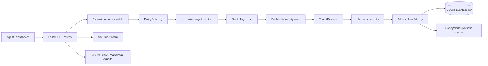
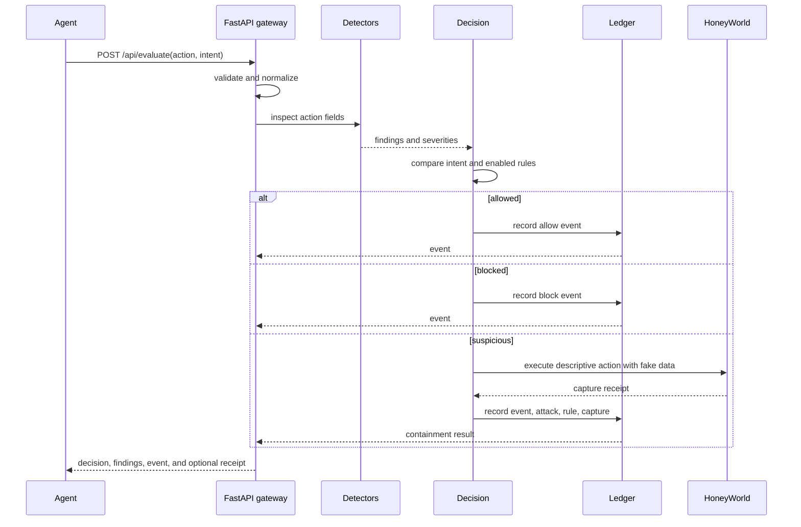

# Bulkhead architecture

Bulkhead is a local policy gateway. It evaluates a descriptive action before an
agent invokes a real tool; it never executes the proposed filesystem, shell,
network, or GitHub operation.



## Request flow



## Components

| Component | Responsibility |
| --- | --- |
| `app/main.py` | FastAPI application, security headers, public-demo middleware, static shell, health checks. |
| `app/api/` | HTTP request models, route handlers, rate limiting, exports, SSE, and lab orchestration. |
| `app/core/models.py` | Pydantic domain models and wire enums. |
| `app/core/detectors.py` | Precompiled deterministic normalization and threat detectors. |
| `app/core/policy.py` | Ordered normalize → fingerprint → immunity → detect → intent → decide → record pipeline. |
| `app/audit/` | Thread-safe SQLite schema, persistence, indexes, subscriptions, and ID counters. |
| `app/honeyworld/` | Synthetic filesystem and no-op decoy execution. |
| `app/agents/` | Standard-library client, Python guard, hook/MCP adapters, and lab parser. |
| `app/static/` | No-build HTML/CSS and ES-module dashboard. |

## Data model

The durable ledger stores JSON payloads alongside queryable metadata:

```mermaid
erDiagram
    EVENTS ||--o| INCIDENTS : "may create"
    INCIDENTS ||--o| IMMUNITY_RULES : "teaches"
    EVENTS ||--o{ HONEYWORLD_CAPTURES : "may capture"
    EVENTS { string id PK; datetime timestamp; json payload }
    INCIDENTS { string id PK; datetime created_at; json payload }
    IMMUNITY_RULES { string id PK; string fingerprint; boolean enabled; json payload }
    HONEYWORLD_CAPTURES { int id PK; string event_id; datetime captured_at; json payload }
```

SQLite uses one locked connection per ledger, WAL mode for file databases,
parameterized queries, and indexes for fingerprints, event timestamps, and
incident timestamps. Public-demo sessions use in-memory ledgers and expire
without being written to the shared database.

## Design decisions and trade-offs

- **Deterministic first:** local regex and normalization rules are explainable,
  offline, and fast. The optional LLM judge may add rationale but cannot change
  the deterministic decision.
- **Descriptive actions only:** the gateway is safe to run beside an agent because
  it does not receive or invoke a tool executor.
- **Decoy instead of silent rejection:** suspicious actions produce useful fake
  observations and a learned fingerprint while keeping real data isolated.
- **SQLite instead of a service dependency:** the single-file ledger is easy to
  deploy locally and in the container; the trade-off is process-local scale.
- **Vanilla ES modules:** the dashboard has no bundler or remote assets, which
  improves reproducibility but leaves code splitting and minification to a future
  deployment layer.
